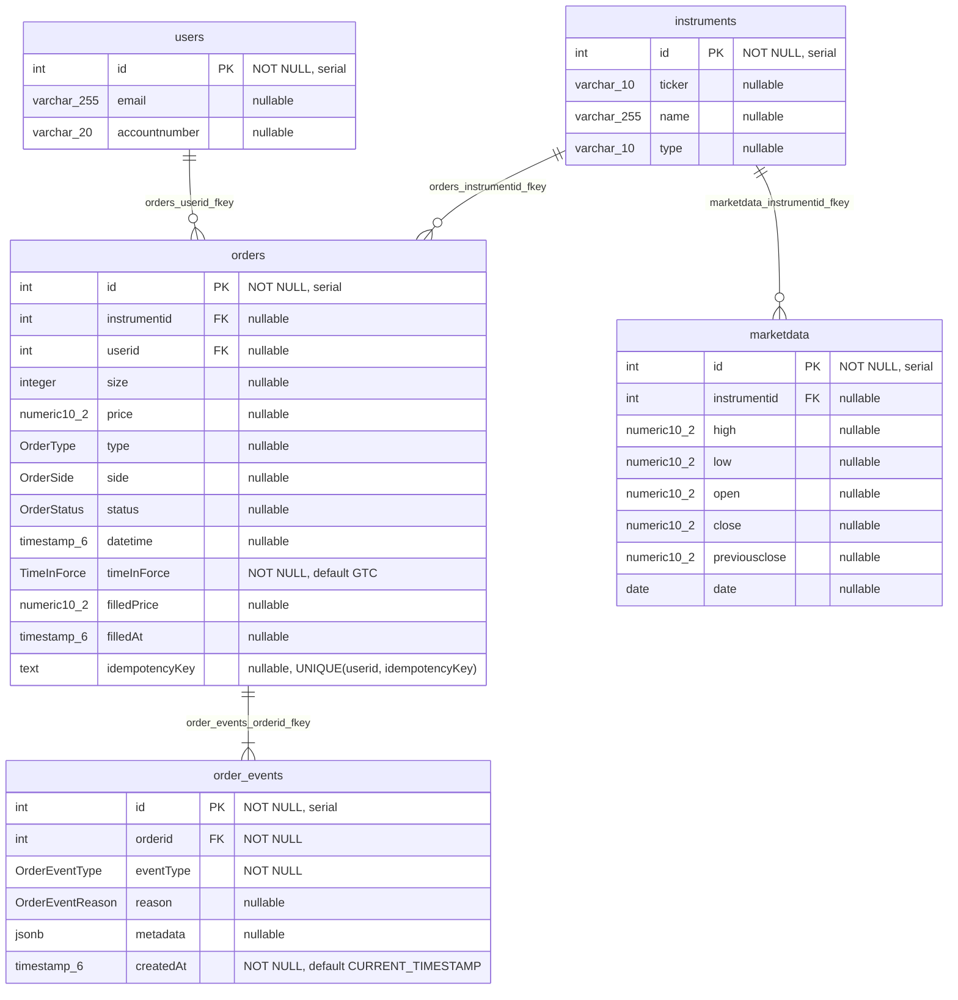
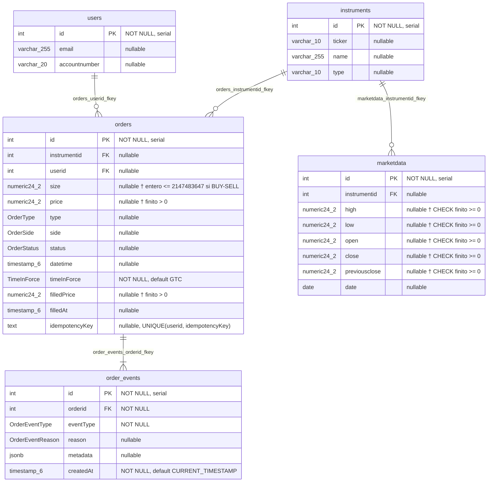

# Esquema PostgreSQL antes/después — migración `20261105104903_large_money`

Diagrama **antes/después** del esquema de negocio (5 tablas), derivado estrictamente de los
catálogos observados durante el gate G0 read-only (2026-11-05). Sigue siendo válido como
**objetivo** del cambio de tipos y CHECKs de `20261105104903_large_money`, y como registro fiel
de lo observado en ese gate.

> **Actualización posterior — gate G3 (2026-11-06):** la migración **sí quedó aplicada** a la base
> de la app `127.0.0.1:5433/cocos_challenge` (`PROGRESS.md`, fila A3 / G3 y §ROLLOUT CERRADO:
> `migrate deploy` con 2 migraciones aplicadas, 0 `rolled_back`, los 6 CHECK verificados por nombre
> y definición contra el SQL versionado, 8 columnas `NUMERIC(24,2)`, segundo `migrate deploy` sin
> pendientes). Por lo tanto el "antes" de este documento es el estado **previo al rollout**, no el
> vigente.

## Fuentes y limitación

| Fuente | Qué observa |
|---|---|
| Snapshot **antes**: catálogo real de la app — `127.0.0.1:5433/cocos_challenge` (G0, 2026-11-05T23:39:41Z, read-only, migración única `20261103003419_init_trading_api`) | Estado de la app **antes de G3** (hoy: histórico) |
| Snapshot **después**: catálogo real del target de test — `127.0.0.1:55432/cocos_rollout_main_gate_test` (mismas migraciones + `20261105104903_large_money` aplicada) | Estado objetivo, validado en TEST y luego aplicado en la app por G3 |

- Ambos snapshots contienen **sólo estructura** (columnas, tipos, nullabilidad, defaults,
  constraints, índices, enums): ni credenciales ni datos de usuarios ni economía de las filas.
- Limitación: son snapshots puntuales observados, no una garantía de futuro; cualquier cambio
  posterior al esquema invalida este documento hasta re-observar.
- `appMigrationPerformed: false` y `databaseWritesPerformed: false` en el registro del G0: en ese
  momento la base de la app **no** había sido migrada. Eso describe el G0, **no** el estado final:
  el gate posterior G3 aplicó `20261105104903_large_money` sobre `cocos_challenge` (ver la
  actualización del encabezado y `PROGRESS.md`).

## Qué cambia y qué no

**Cambian exactamente 8 columnas** (tipo físico, en 2 tablas); **no cambian**: tablas, nombres de
columnas, nullabilidad, defaults, enums, PK/FK, índices ni la cardinalidad de las relaciones.

| # | Tabla | Columna | Antes (app) | Después (TEST) |
|---|---|---|---|---|
| 1 | `marketdata` | `high` | `numeric(10,2)` | `numeric(24,2)` |
| 2 | `marketdata` | `low` | `numeric(10,2)` | `numeric(24,2)` |
| 3 | `marketdata` | `open` | `numeric(10,2)` | `numeric(24,2)` |
| 4 | `marketdata` | `close` | `numeric(10,2)` | `numeric(24,2)` |
| 5 | `marketdata` | `previousclose` | `numeric(10,2)` | `numeric(24,2)` |
| 6 | `orders` | `size` | `integer` | `numeric(24,2)` |
| 7 | `orders` | `price` | `numeric(10,2)` | `numeric(24,2)` |
| 8 | `orders` | `filledPrice` | `numeric(10,2)` | `numeric(24,2)` |

Lecturas de la tabla:

- **Dinero pasa de `integer`/`numeric(10,2)` a `numeric(24,2)`, nunca a `Float`** (regla
  innegociable: dinero jamás en float). `numeric(24,2)` da capacidad para un máximo por valor
  almacenado de **9999999999999999999999.99 ARS** (22 dígitos enteros + 2 decimales, verificado con
  `Decimal` de Python, no a ojo). El contrato HTTP ya rechaza entradas con más de 2 decimales y
  valores por encima del máximo antes de persistir.
- `orders.size` deja de ser `integer`: para **BUY/SELL sigue siendo acciones enteras** — el CHECK
  `orders_share_size_int4_check` exige entero y `<= 2147483647` (cota INT4) — y para
  **CASH_IN/CASH_OUT pasa a ser monto en ARS con centavos** (misma columna, unidad discriminada por
  `side`). La firma D1–D5 y UC-2 no cambian.

## Las 6 restricciones CHECK nuevas (todas admiten NULL)

La migración sólo agrega CHECKs sobre las columnas que toca; **un NULL heredado sigue siendo
válido en los seis** (no se endurece la nullabilidad legacy ni se reparan datos: los centavos
perdidos por el typmod anterior no se reconstruyen).

| Constraint | Tabla | Regla (para valores no NULL) |
|---|---|---|
| `orders_price_finite_positive_check` | `orders` | `price` finito (`<> NaN`) y `> 0` |
| `orders_filledprice_finite_positive_check` | `orders` | `filledPrice` finito y `> 0` |
| `orders_size_finite_non_negative_check` | `orders` | `size` finito y `>= 0` |
| `orders_size_zero_only_rejected_check` | `orders` | `size = 0` sólo con `status` `IS NOT DISTINCT FROM 'REJECTED'` (un `status` NULL evalúa FALSE ⇒ rechazado; `size` positivo con `status` NULL sigue permitido) |
| `orders_share_size_int4_check` | `orders` | si `side` es `BUY`/`SELL`: `size` entero (`= trunc(size)`) y `<= 2147483647`; el cash no pasa por acá |
| `marketdata_prices_finite_non_negative_check` | `marketdata` | las 5 cotizaciones finitas y `>= 0` (cada una con su propio `IS NULL OR …`) |

El SQL exacto, tal como quedó en la migración personalizada bajo la excepción D5:

<details>
<summary><code>prisma/migrations/20261105104903_large_money/migration.sql</code> — fragmento CHECKs</summary>

```sql
ALTER TABLE "orders"
  ADD CONSTRAINT "orders_price_finite_positive_check" CHECK (
    "price" IS NULL OR ("price" <> 'NaN'::numeric AND "price" > 0)
  ),
  ADD CONSTRAINT "orders_filledprice_finite_positive_check" CHECK (
    "filledPrice" IS NULL OR ("filledPrice" <> 'NaN'::numeric AND "filledPrice" > 0)
  ),
  ADD CONSTRAINT "orders_size_finite_non_negative_check" CHECK (
    "size" IS NULL OR ("size" <> 'NaN'::numeric AND "size" >= 0)
  ),
  ADD CONSTRAINT "orders_size_zero_only_rejected_check" CHECK (
    "size" IS NULL OR "size" <> 0 OR "status" IS NOT DISTINCT FROM 'REJECTED'::"OrderStatus"
  ),
  ADD CONSTRAINT "orders_share_size_int4_check" CHECK (
    "size" IS NULL
      OR "side" IS NULL
      OR "side" NOT IN ('BUY', 'SELL')
      OR ("size" = trunc("size") AND "size" <= 2147483647)
  );

ALTER TABLE "marketdata"
  ADD CONSTRAINT "marketdata_prices_finite_non_negative_check" CHECK (
    ("high" IS NULL OR ("high" <> 'NaN'::numeric AND "high" >= 0))
    AND ("low" IS NULL OR ("low" <> 'NaN'::numeric AND "low" >= 0))
    AND ("open" IS NULL OR ("open" <> 'NaN'::numeric AND "open" >= 0))
    AND ("close" IS NULL OR ("close" <> 'NaN'::numeric AND "close" >= 0))
    AND ("previousclose" IS NULL OR ("previousclose" <> 'NaN'::numeric AND "previousclose" >= 0))
  );
```

</details>

Límite documentado en la propia migración: el typmod `NUMERIC(24,2)` redondea una entrada con más
de dos decimales **antes** de evaluar el CHECK (p. ej. `1.005 → 1.01`) y rechaza
`Infinity`/`-Infinity` por overflow; los CHECKs garantizan el valor almacenado, no la precisión de
una escritura SQL externa.

## Lo que esta migración NO agrega (no atribuir al diagrama)

- **No hay CHECK de estados de la máquina** (`NEW→FILLED`, etc.): la guarda sigue siendo a nivel
  app (`WHERE status='NEW'`); es deuda conocida, no garantía DB.
- **No hay CHECK sobre cash/price/unit** que esta migración introduzca: sólo los seis de arriba.
- **No hay trigger DB** para la auditoría: `order_events` es append-only por regla de la app
  (misma tx, primera escritura con `ON CONFLICT`), no por un disparador.
- **No existen ni se crean** tablas de saldo, `price_ticks`, ingesta ni nada de Yahoo: el ERD de
  abajo es el esquema completo de negocio (5 tablas).
- `_prisma_migrations` es tabla técnica de Prisma, fuera del ERD: al aplicar la migración sólo se
  **suma un registro** a esa tabla existente; no se crea ninguna tabla nueva de negocio.

## ERD antes (estado observado en la app — `cocos_challenge`, puerto 5433; G0, previo a G3)



Índices (idénticos en ambos estados): `*_pkey` (5 PK), `marketdata_instrumentid_date_idx`,
`order_events_orderid_idx`, `orders_status_instrumentid_idx`, `orders_userid_status_idx` y el
**UNIQUE compuesto `orders_userid_idempotencyKey_key (userid, idempotencyKey)`** — que ya existía
y se mantiene, no es nuevo.

## ERD después (estado objetivo validado en TEST — `cocos_rollout_main_gate_test`, puerto 55432; desde G3 también el estado de la app)

Misma topología y mismas cardinalidades; cambian sólo los 8 tipos marcados con †.



Cardinalidades derivadas de la nullabilidad observada: `orders.userid`/`orders.instrumentid` son
NULLables ⇒ `||--o{` (cero órdenes por usuario/instrumento, y una orden puede no referenciarlos);
`order_events.orderid` es NOT NULL ⇒ `||--|{` (toda orden puede tener N eventos; todo evento tiene
exactamente una orden).

## Verificación de este documento

Los dos ERD y la tabla de cambios fueron verificados programáticamente contra los JSON de
catálogo (5 tablas presentes, todas las columnas físicas con nombres exactos, los 8 cambios de
tipo exactos); ver el HTML par (`db-schema-before-after.html`) para la versión gráfica.
